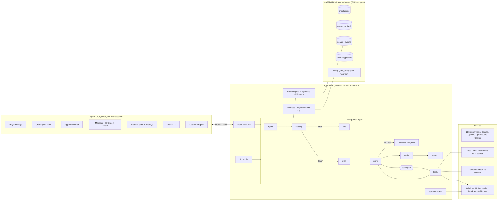

# Architecture

Two processes plus an optional container. The UI is a pure client: closing it never stops a running task.

## One turn
1. `ingest` detects Vietnamese/English, builds the message (text + images + extracted documents + transcribed audio).
2. `classify` (cheap model) decides chat / question / task and risk; a low-confidence answer asks one clarifying question.
3. Simple questions go straight to `fast`; tasks go to `plan` (goal, success criteria, steps, optional parallel sub-agents) and a worker loop.
4. **Every tool call passes the gate** before it runs: policy tier (T0 auto, T1 auto unless the task has seen untrusted content, T2 human approval, T3 denied),
   path/command/domain rules, rate limits, kill switch. Approvals are stored on disk, survive restarts and are answered from the UI.
5. `verify` checks the success criteria (bounded replans), `respond` answers. Token/cost budgets, step limits and no-progress detection are enforced in code.

## Where things live
| Piece | Code |
|---|---|
| Daemon, API, lifecycle | `core/` (`app.py`, `admin.py`, `attachments.py`, `main.py`) |
| Graph, budgets, sub-agents | `graph/` |
| Providers and routing | `llm/factory.py`, `config/default.yaml` (`models:`) |
| Policy, approvals, kill switch | `policy/`, `config/policy.yaml` |
| Tools (one module per group) | `tools/` registered in `tools/registry.py` |
| Docker sandbox, staging/diff/apply/undo | `sandbox/` |
| Screen perception and control | `perception/`, `tools/screen_tools.py` |
| Memory, RAG | `memory/`, `rag/` |
| Metrics, tracing, audit, logs | `observability/` |
| UI | `ui/` |
| Damaged-file handling | `storage.py` |
| Settings, secrets | `settings/` |

## Trust boundaries
- The local API only listens on loopback, needs the per-install token and rejects foreign `Origin` headers.
- Tool outputs, web pages, emails, clipboard text, documents and **everything read from the screen** are untrusted data: they taint the task, and side effects that follow need approval.
- The agent cannot edit its own policy, config, MCP list, database files or audit log (they live in a denied path; policy/settings are changed only through the authenticated UI/API).
- Secrets live in Windows Credential Manager (or a git-ignored `.env`), are redacted from logs, traces, audit entries, tool output and WebSocket events, and are write-only in the UI.
