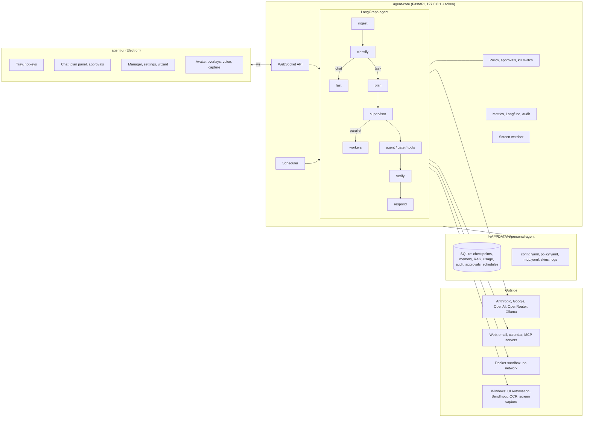

# Architecture

A single-user, Windows-first agent: a local **daemon** runs the agent, a separate **UI** process is a pure client. Cloud LLMs by default; everything else is local.

## Processes
- **`agent-core`** hosts the graph, tools, memory, RAG, policy, scheduler, screen watcher and observability. It binds to `127.0.0.1` only and refuses anything else.
  Every WebSocket / `POST /kill` request needs the per-install token; foreign `Origin` headers are rejected; `GET /health` returns only `{"status":"ok"}`.
- **`agent-ui`** (Electron, `electron-ui/`) talks to the daemon only through one WebSocket held by its main process (auto-reconnect). Closing or crashing it never stops a task; on reconnect the daemon re-sends pending approvals.
  The UI holds no agent state (`src/shared/session.ts` is a view of the event stream, run identically in the main process and in each window).
  Every window is sandboxed with a strict content-security policy and no Node access; the token never leaves the main process; model output is rendered as markdown without raw HTML;
  only the approval window may answer an approval; only the hidden voice window gets the microphone. Avatar, bubble, radial menu and screen overlays are separate small windows created on first use.
- **Docker sandbox** (optional, lazy): see below. **`agent-chat`** is a terminal client with the same protocol.

## One turn
1. `ingest` detects Vietnamese/English and builds the message: text, images, extracted documents (md/txt/csv/docx/pdf), transcribed audio. Anything attached marks the task *tainted*.
2. `classify` (cheap model, structured `Intent`). Low confidence with a clarifying question → ask one question and stop.
3. Chat / simple question → **fast path** (one worker call, no planner, no verifier). Otherwise `plan` produces a `Goal` with checkable success criteria and steps, each with a `role` and `depends_on`.
4. **Sub-agents.** The supervisor delegates only *independent information-gathering* steps (≥ `min_delegable`) to parallel workers in waves of `max_parallel`; writes, sending and composing the answer stay in the supervisor.
   Workers have their own small context, only the tools of their role, a slice of the remaining budget, and **never ask for approval**: if the policy says "approve" they stop and report it, and the supervisor asks.
5. Worker loop `compact → agent → gate → tools → account`. **Every tool call passes the `gate` first** (policy tier, path/command/domain rules, rate limit, kill switch, taint); calls needing a human go into one `interrupt()`.
   The gate is idempotent, so resuming after an approval never re-runs a tool.
6. `verify` (critic, structured `Verdict`) must mark *every* criterion met for a planned task to end `done`; otherwise bounded replans. `respond` answers.

Limits are enforced in code, not by the model: per-task steps / tool calls / seconds / tokens / USD / consecutive failures / replans / verifications, no-progress detection (same call 3× in 6), and a **daily** token + USD cap persisted in SQLite and checked before every model call
(parallel workers *reserve* their worst case first, so branches cannot overshoot together). Big tool outputs are stored as artifacts and old turns summarised (`compact_tokens`).

## Models and routing (`config/default.yaml`, editable in Settings)
| Role | Default | Notes |
|---|---|---|
| planner, critic | Claude Haiku 5.5 | structured output; fallbacks Gemini flash-lite → gpt-4o |
| classifier, vision | local `gemma4:e2b` (Ollama, thinking off) | fallbacks Haiku → Gemini flash-lite → gpt-4o; a reply that is not valid JSON also moves to the next model |
| fast, summarizer, worker | Gemini 3.5 flash-lite | fallbacks Haiku → gpt-4o |
| embeddings | Ollama `bge-m3`, 1024 dims | local, multilingual; changing model/dimension re-indexes automatically |
| speech-to-text / text-to-speech | Gemini audio / edge-tts | STT is a metered daemon call; TTS runs in the UI |

Fallback models are built only when the primary fails (a provider SDK costs 40-90 MB). Unknown models are priced pessimistically so nothing looks free. `gemma4:e4b` with thinking on was rejected (13-65 s per call, invalid JSON); `gemma4:e2b` with thinking off passed the 10 evals at ~3-4 s more per turn than Haiku (measured 2026-11-02), so it is the default for classifier and vision.

## Tools
All registered in `tools/registry.py` with policy metadata (tier, side effects, untrusted output, risk, preview, "remember" scope, attended-only).
| Group | Tools | Tier |
|---|---|---|
| Files | `file_read/list/search` · `file_write/edit/move/delete`, `undo_change` | T0 · T2 (backed up, undoable) |
| Shell, code | `shell` (read-only allow-list runs unattended, else T2) · `run_python`, `sandbox_*` (Docker) | T1-T2 |
| Web | `web_search` (DuckDuckGo, pluggable), `web_fetch`, `browser_read` (Playwright), `http_request` (named secrets, listed hosts only) | T0-T1, SSRF-safe |
| Mail, calendar, clipboard | `email_search/read` (T0), `email_send` (T2) · `calendar_list` (T0), `calendar_add` (T2; local `.ics`) · `clipboard_read` (T0), `clipboard_write` (T2) | |
| Knowledge | `rag_*`, `remember`, `recall`, `forget` | T0-T1 (sensitive memory T2) |
| Scheduling | `schedule_task` (T2, attended only), `schedule_list/cancel` | |
| MCP | any server in `mcp.yaml`, namespaced `<server>_<tool>` | T2 unless you classify it |
| Screen | `screen_windows`, `screen_describe`, `screen_ocr`, `ui_tree` (T0, untrusted) · `ui_act` (T2, attended only, never remembered) | |

## Knowledge
- **RAG:** structure-aware chunks (never across a heading/page), incremental by SHA-256, embed-before-write; sqlite-vec + FTS5 with Vietnamese diacritic folding; score = 0.7 × cosine + 0.3 × coverage²; answers cite file / heading / page.
  A folder watcher (`rag.watch`, inside the allowed paths) keeps folders indexed.
- **Memory:** semantic / episodic / procedural. At task start the top memories (BM25, no API call) are injected as information, not instructions. After planned tasks the cheap model *proposes* memories; they become active only if confident, non-sensitive and
  from a task that read no untrusted content, otherwise they wait for your approval. 90-day half-life; list/edit/approve/delete everything.

## Sandbox and staging
Started lazily, auto-stopped when idle (300 s): `--network none`, all capabilities dropped, no-new-privileges, read-only root, non-root, 1 CPU / 512 MB / 128 pids, **one** bind mount (the staging folder).
Files are copied in, the agent works on copies, the diff against the originals (added / modified / deleted / conflict) is shown on an approval card, you approve per file, and only then it is applied with a backup and `undo_change`. No Docker → `sandbox_*` report it and host tools stay T2.

## Screen perception and control
Structured first: UI Automation (names, roles, rectangles, Invoke pattern) → Windows OCR (local) → vision model on request. Input is `SendInput`. Continuous watching (`ScreenWatcher`) is low-FPS with perceptual-hash change detection, in memory only, opt-in, auto-off.
Privacy blocklist and control restrictions are in [security.md](security.md).

## Observability
Local SQLite metrics (latency, errors, tool success per day; "Usage" page and `/usage`) are always on; optional Langfuse traces (payloads redacted before export); structured JSON logs with rotation and redaction under `%APPDATA%\personal-agent\logs`;
append-only audit log of every tool call. Eval harness: `agent-eval` ([development.md](development.md)).

## Storage and resilience
One SQLite file per store plus yaml. A damaged config or database is renamed `*.corrupt-<time>` / `*.invalid-<time>` and recreated (never deleted); a broken `policy.yaml` edit keeps the last good rules. `policy.yaml` edited in the UI is saved to `%APPDATA%\personal-agent\policy.yaml`
(the shipped copy may be read-only). Messages are capped (32 MB frame, 4 attachments, 15 MB) and turns are queued (≤ 8).

## Footprint (measured, idle, Windows 11)
Daemon ~106 MB, ~183 MB after the first chat (provider SDKs load on demand), start-up ~4 s; daemon CPU ~0 % with no polling (the scheduler sleeps to the next job, the screen watcher exists only while on).
Desktop UI (Electron, packaged, idle with the chat, approval and avatar windows): ~186 MB private memory in 6 processes, ~2 % of one core while the avatar animates. Each further companion window (bubble, radial menu, overlays, voice) is one more process, created on first use.
The original targets (daemon ≤ 100, UI ≤ 60, combined < 150 MB, start ≤ 3 s) are not reachable with Electron + LangGraph; see [decisions.md](decisions.md). Measure the daemon with `scripts/profile_resources.py`; the UI shows its own numbers under Settings → About.
